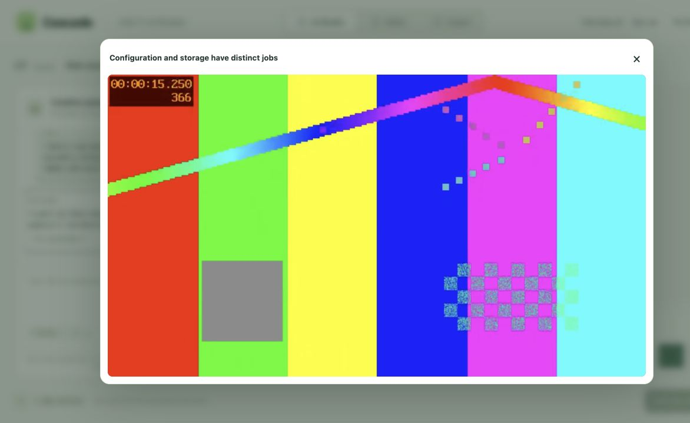

# CAS-11 verification

Verified October 29, 2026 against committed revision `6d76fd7` and the current working tree.

## Implementation

Configuration and dotenv initialization live in `backend/core/config.py`. The eight storage helpers and profile cache live in `backend/core/storage.py`. Explicit imports preserve the existing `app1` interface. Auth remains in `app1`; storage defers its Clerk profile import to avoid a cycle. Storage tests patch dependencies where the moved functions now look them up.

The original implementation reduced `app1.py` by 248 lines. Its baseline, configuration-only, and final storage-move runs each passed all 126 tests.

## Final verification

- Clean committed snapshot: `CASCADE_METADATA_STORE=local CASCADE_WARM_MODELS=0 python3 -m unittest discover -s tests -p 'test_*.py' -q` — **239 tests passed**.
- Current working tree: same command — **264 tests, 263 passed, one failure**. The route snapshot differs because the separate uncommitted advanced editor work adds three routes. The committed snapshot passes this check. No unrelated editor changes were made for CAS-11.
- Browser: created an isolated project through `projects_C.html`, opened `canvas_C.html`, uploaded a synthetic narrated MP4, and requested one clip. The real transcription, model indexing, AI selection, FFmpeg rendering, captions, and local storage completed successfully.
- Generated job: `cbfaebf21d8d4404b30c76a20fa0042b`; title: **Configuration and storage have distinct jobs**. The UI reported **1 of 1 clips ready**.
- Preview loaded with HTML video `readyState=4`, duration **12 seconds**, and no media error. `ffprobe` confirmed video and audio streams and `12.000000` seconds.

The browser check used an isolated localhost server, test identity, local metadata, and `/tmp/cas11-verify/jobs`; existing account data and credentials were not changed. Clerk sign-in was a fixture because the old frontend does not support the existing backend dev-auth response. Generation and storage were not mocked. Configured provider credentials were used only by their normal SDK integrations.

