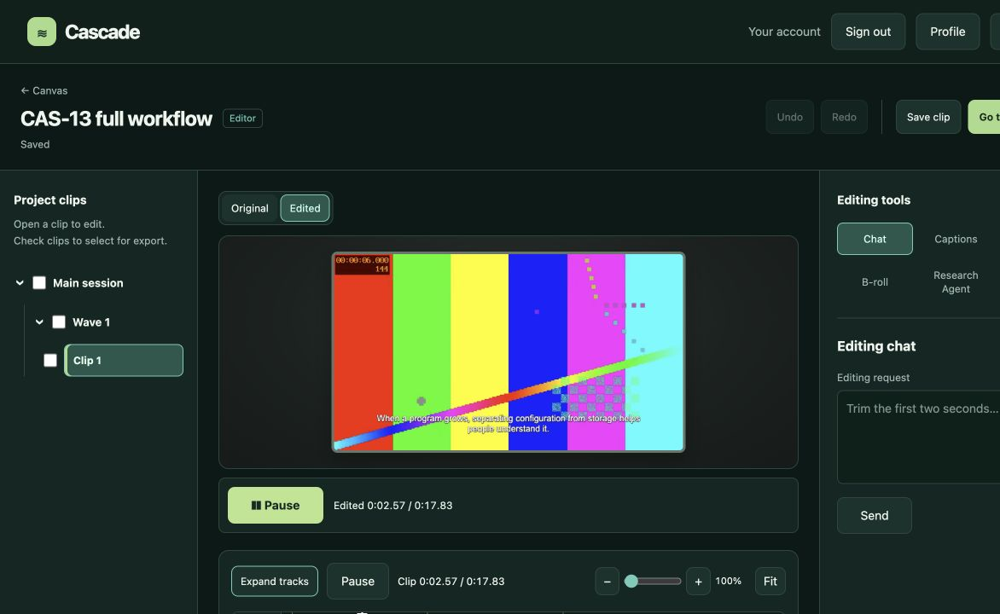
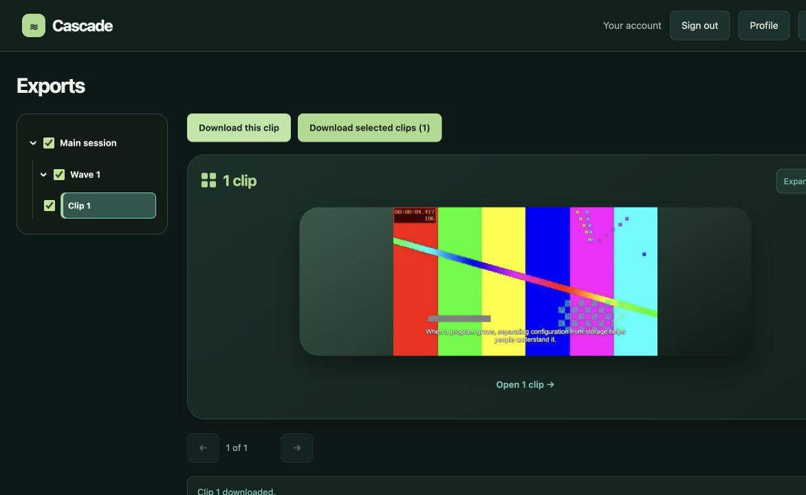

# CAS-13 verification

Completed October 29, 2026.

## Change

`app1.py` is now a two-line compatibility entry point importing `backend.main.app`. The real application is assembled in `backend/main.py` (44 lines), including middleware, startup handlers, page/clip routers, existing feature registration and Studio assets.

- `backend/core/jobs.py`: shared worker, job state/lock, ownership, metadata persistence, cancellation and safe public errors.
- `backend/core/media.py`: FFmpeg execution, media inspection, captions and parallel render helpers.
- `backend/routers/clips.py`: generation worker, upload, job status, clip playback and history routes.
- `backend/routers/pages.py`: frontend routes and thin auth/session/logout endpoints.
- `backend/core/host.py`: temporary service namespace for existing registration adapters. Attributes resolve from their owning modules so the adapters share current job state, roots and service overrides rather than stale copies.
- `backend/routers/editor_setup.py`: existing editor/posting composition moved verbatim from the old `backend/main.py`.

Editor runtime and storage now import the owning core services instead of `app1`. Unit tests, browser fixtures and local smoke/demo tools use the new service patch targets. Existing unrelated editor changes were preserved.

## Verification

- Baseline and final full suite command: `CASCADE_METADATA_STORE=local CASCADE_WARM_MODELS=0 python3 -m unittest discover -s tests -p 'test_*.py' -q`.
- Baseline: **264 tests, 263 passed, one failure**. Final result matches the baseline. The sole failure is the existing advanced-editor route snapshot mismatch; no new errors/failures.
- All **94 HTTP route contracts** and the **complete OpenAPI document** match the pre-refactor application.
- AST comparison of **30 moved functions/classes** confirms unchanged logic after normalizing only module qualifications and router/startup registration.
- Entry-point/main size limits and `git diff --check` pass.

## Full browser workflow

Started the app using `uvicorn.run('app1:app', ...)` on localhost with isolated local metadata/media under `/tmp/cas13/jobs` and a test sign-in identity. Transcription, AI selection, FFmpeg rendering, captions, editor preview/export and downloads were real; no generation or storage mocks were used. Existing credentials and user data were not changed.

1. Created **CAS-13 full workflow** through `projects_C.html`.
2. Opened `canvas_C.html`, uploaded a synthetic narrated MP4, and requested one clip.
3. Generation completed with **1 of 1 clips ready**, job `67afb54fe77f48d4bf143dee279b1648`, title **How separating configuration and storage aids maintenance**.
4. Selected the clip and used **Continue to Editor**. The editor loaded, saved its draft, loaded thumbnails and played the edited preview with an advancing playhead.
5. Selected the clip for export, opened Exports, and clicked **Download this clip**. The browser reported **Clip 1 downloaded**.
6. `ffprobe` verified the actual browser-downloaded MP4: **17.833333 seconds**, **640×360 video**, and an **audio stream**.

The local verification server was stopped after completion.

