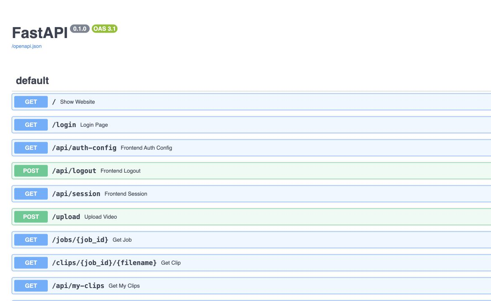

# CAS-18 verification

Completed October 30, 2026 in the existing `mlk` checkout. Existing unrelated editor and frontend changes were preserved.

## Implementation

Replaced `backend/integration.py` and `backend/project_actions.py` with normal FastAPI routers using explicit service dependencies:

- `backend/routers/projects.py`: project CRUD, original source, saved clips and health.
- `backend/routers/settings.py`: owner-scoped preferences.
- `backend/routers/features.py`: research/caption submissions, feature status and cancellation.
- `backend/routers/generations.py`: generation history, creation, retry and project deletion.
- `backend/services/projects_store.py`: shared owner/project/clip/source lookup, project lock, and feature job persistence.
- `backend/services/features.py`: search, caption-style and research workers.

`backend/main.py` includes these routers. The public `/settings` alias remains in the pages router. Existing editor and posting APIs now use the project store; posting persistence imports job services directly.

Studio was a newer remaining consumer of `register(app, host, integration)`. Its routes now use an APIRouter, its helpers import the project store and job services explicitly, and upload callers no longer pass host/integration arguments. This allowed deleting the entire temporary `backend/core/host.py` adapter as well as both old integration modules. Updated unit tests and browser/Neon fixtures to import the owning services. No URL, validation, ownership, locking or job behavior was intentionally changed.

## Verification

- Full suite command: `CASCADE_METADATA_STORE=local CASCADE_WARM_MODELS=0 python3 -m unittest discover -s tests -p 'test_*.py' -q`.
- Baseline: **264 tests, 263 passed, one failure**.
- Final: **264 tests, 263 passed, the identical one failure**. The existing advanced editor route snapshot mismatch predates CAS-18; there are no new failures or errors.
- All **94 HTTP route path/method contracts** are identical before/after. The sorted baseline is saved in `cas-18-routes.json`.
- The **complete OpenAPI document** is identical before/after, including request/response schemas and operation IDs.
- Structural AST comparison of **67 moved functions/models** confirms unchanged logic after normalizing service qualifications, removal of injected dependency parameters, and router registration. Two deferred upload-orchestration imports avoid dependency cycles.
- `/docs` was opened in a real browser before and after; screenshots below show the same endpoint inventory. The rendered page contains **64 documented operations**. Hidden frontend aliases account for the larger HTTP contract count.
- Live localhost smoke checks, using real dev auth and isolated local metadata, passed: health, project creation/list/rename/get/delete, settings save/load, empty generation history, Studio load/session creation/rename, and 404 for unknown project/feature IDs. The live `/openapi.json` also equals the saved baseline. No paid providers or existing account data were used for these checks.
- No production/test imports of the removed integration/project-actions/host modules remain. No `register(app, host, ...)` remains.
- `git diff --check` passes. The local verification server was stopped afterward.

## Swagger screenshots

[Before](cas-18-docs-before.png) · [After](cas-18-docs-after.png)

