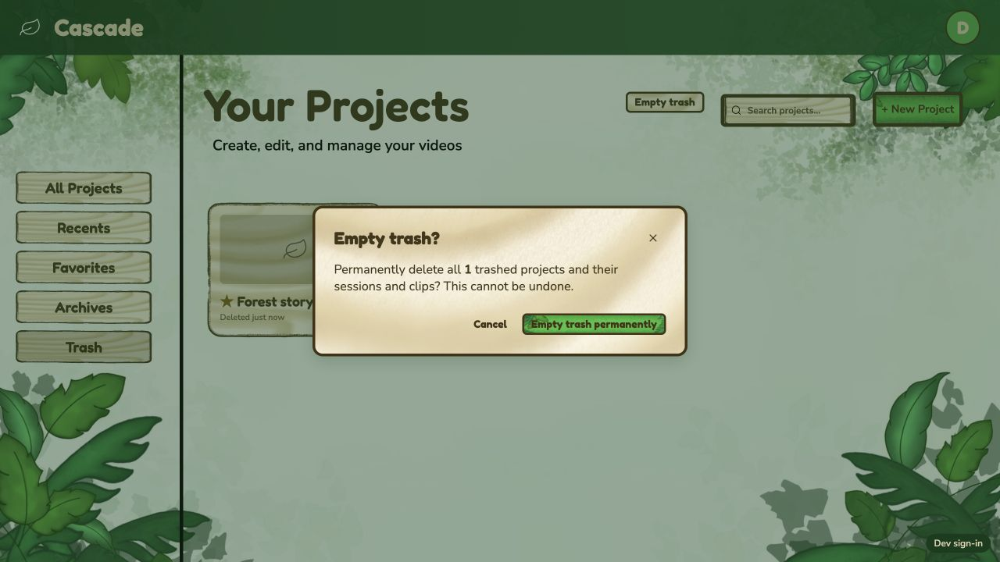
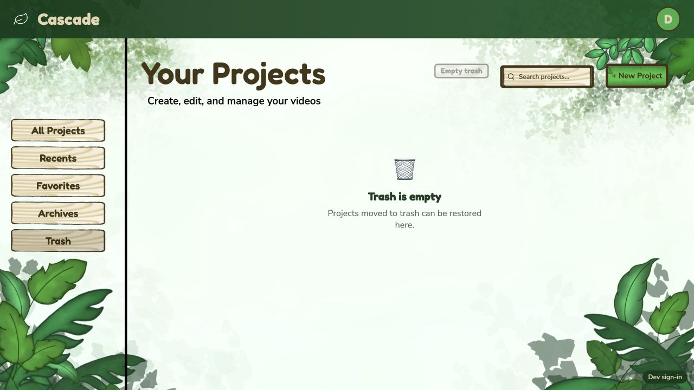

# CAS-59 / ticket 7.5 verification

Completed October 30, 2026 in the existing `mlk` checkout. Changes are uncommitted; existing unrelated work was preserved.

## Behavior

Projects now persist `favorite`, `archived` and `trashed_at`. Old records receive false/false/null defaults on read without being rewritten. The owner-checked project PATCH endpoint supports partial name/flag updates, rejects null/non-boolean flags and unknown metadata fields, and preserves unrelated project data. GET continues returning all owned projects for frontend filtering.

The React Projects page now has five functional views: All Projects, Recents (seven days), Favorites, Archives and Trash. All/Recents exclude archived and trashed projects; Favorites includes archived favorites but excludes trash. Project menus support favorite/unfavorite, archive/unarchive and trash/restore. Favorite cards show a star. Trashed cards show deletion time and can be restored, preserving previous archive/favorite choices.

Empty Trash requires a confirmation modal and uses the existing DELETE endpoint for every trashed project. Partial failures remain visible and show an error while successful deletions are removed. Active/archive projects are never included in the bulk deletion. Search does not silently limit the modal's “all trashed projects” operation.

## Validation

- Seven new backend lifecycle tests pass: old defaults, persistence/reload, metadata preservation, restore behavior, ownership, validation, permanent deletion and active-job protection.
- Full backend suite: **271 tests, 270 pass, one pre-existing editor route-snapshot failure**. Baseline: **264 tests, 263 pass, the same failure**. No new failures/errors.
- Frontend tests: **20/20 pass**, including view exclusions, old-record compatibility, recent timestamps, restore behavior, bulk partial failures and no-op empty trash.
- Production frontend build succeeds. Lint succeeds with existing warnings in ProjectContext and unrelated editor components; no warnings in the CAS-59 files. `git diff --check` passes.

## Browser / real API verification

Used the production React build with the real backend and dev authentication on localhost, with isolated synthetic projects under `/tmp/cas59/browser-jobs`. Existing account data was not changed.

Verified favorite → Favorites, archive → Archives, All/Recents exclusions, old projects excluded from Recents, move to Trash with deletion time, restoration preserving favorite/archive state, and persistence after reload. Verified the Empty Trash modal and Cancel keeping the project intact.

Ran the exact production bulk-deletion helper against the isolated real API: it deleted the synthetic trashed project and preserved both active projects. Browser reload then showed **Trash is empty** with Empty Trash disabled, and All Projects still contained the active projects. The seven backend tests also cover owner checks and rejection of deletion while jobs are active. The local server was stopped afterward.

